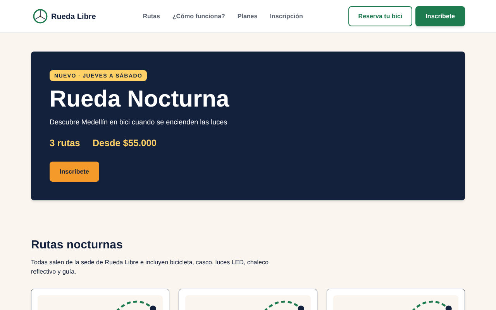
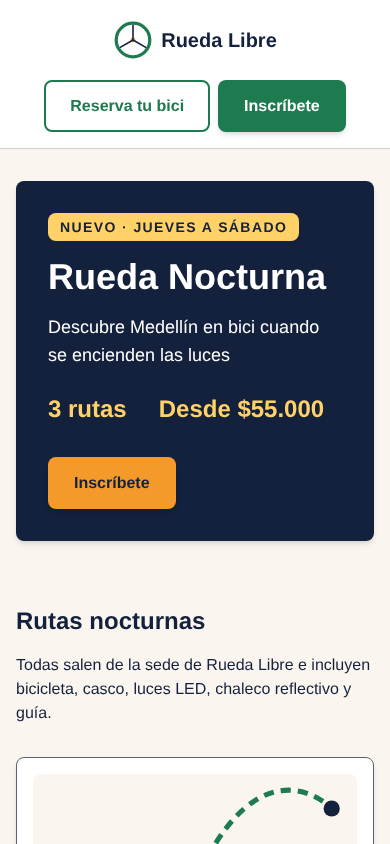
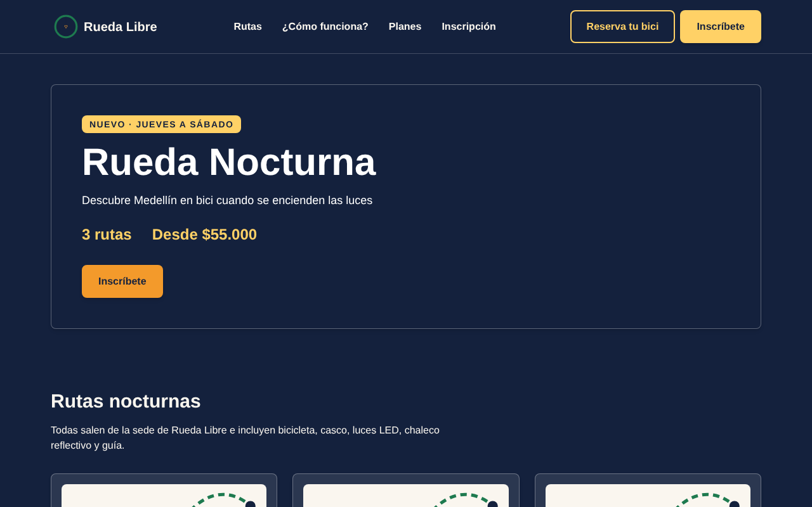

# Rueda Libre

Sitio web de alquiler de bicicletas en Medellín, con la campaña **Rueda Nocturna**.

## Enlaces publicados
- Sitio principal: ____________________
- Landing Rueda Nocturna: ____________________/nocturna/index.html
- Kit de componentes: ____________________/nocturna/componentes.html

## Páginas
- `index.html`, `paginas/tarifas.html`, `paginas/reservas.html`: sitio principal (HTML y CSS).
- `nocturna/prototipo.html`: prototipo con Play CDN.
- `nocturna/index.html`: landing con Tailwind (rutas, pasos, planes e inscripción).
- `nocturna/componentes.html`: kit de botones, card, alertas y campos.

## Tecnologías
HTML, CSS, Tailwind CSS 4 (CLI), Google Fonts (Montserrat y Open Sans), GitHub Pages.

## Cómo compilar Tailwind
```
cd nocturna
npm install tailwindcss @tailwindcss/cli
npx @tailwindcss/cli -i ./src/input.css -o ./src/output.css --watch
npx @tailwindcss/cli -i ./src/input.css -o ./src/output.css --minify
```

## Capturas




## Recomendación de framework
Ver `nocturna/bitacora.txt` (MiniReto 8).

## Aprendizajes
____________________

## Autor
Johan Sebastian Cardona Gonzalez
